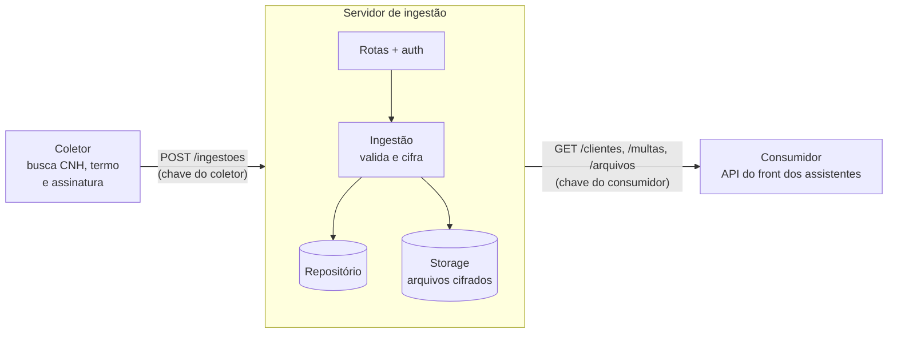

# Braço Direito · Servidor de ingestão segura

> API em Node.js que recebe documentos sensíveis de condutores (CNH, termo de responsabilidade, assinatura), guarda tudo **cifrado com AES-256-GCM** e serve os dados a outro serviço com autenticação por papel.

Projeto real de trabalho, desenvolvido para uma empresa de aluguel de motos elétricas. Os assistentes do time de multas precisam **indicar o condutor** de cada multa ao órgão de trânsito, e para isso juntam os dados do cliente, a CNH e o termo assinado. O Braço Direito automatiza essa coleta. Este repositório é a **versão pública do servidor**: sem dados reais, sem integrações internas, com dados de exemplo fictícios.

**Feito em par com IA:** este projeto foi construído com o [Claude Code](https://claude.com/claude-code) (modelo Claude Opus), da Anthropic. Veja [Como usei o Claude](#como-usei-o-claude).

---

## Arquitetura



**Decisão principal: o banco fica atrás da API.** Só este servidor acessa o banco e a chave de criptografia. O consumidor nunca lê o banco direto: ele pede pela API e recebe os dados já decifrados. Na prática, isso significa:

- **a chave de criptografia fica num lugar só**, e um vazamento no outro serviço não abre os dados;
- **o esquema do banco pode mudar** sem quebrar quem consome, desde que a API responda igual;
- **toda leitura de dado pessoal passa por um ponto auditável**.

## Segurança

| O quê | Como |
|---|---|
| **Campos sensíveis** (nome, CPF, RG, nº da CNH, nº do espelho) | AES-256-GCM, um IV aleatório por valor, formato `v1.<iv>.<tag>.<dados>` (o `v1` permite trocar algoritmo ou chave no futuro) |
| **Arquivos** (PDF/PNG/JPG) | Cifrados com a mesma chave antes de ir para o disco, com nome aleatório (UUID): nenhum dado pessoal no caminho |
| **Integridade** | A *auth tag* do GCM rejeita qualquer dado adulterado em vez de devolver lixo |
| **Autenticação** | Chave de API por papel: o **coletor** só escreve, o **consumidor** só lê. Comparação em tempo constante (`timingSafeEqual`) |
| **Uploads** | Tipo validado pelo conteúdo (*magic bytes*), não pela extensão; limite de 10 MB e 20 arquivos |
| **Configuração** | O servidor não sobe com chave fraca, curta ou repetida |
| **Logs** | Nunca registra corpo de requisição, CPF ou nome; erro inesperado vira `500` genérico |

## Endpoints

| Método | Rota | Papel | O que faz |
|---|---|---|---|
| `POST` | `/ingestoes` | coletor | Recebe um cliente (`multipart`: campo `dados` em JSON + arquivos). Reenvio substitui o anterior e apaga os arquivos antigos |
| `GET` | `/clientes/:userId` | consumidor | Cliente com o OCR decifrado e os ids dos arquivos |
| `GET` | `/multas/:ait` | consumidor | Multa pelo AIT (aceita hífen e minúsculas) + dados do condutor |
| `GET` | `/arquivos/:id` | consumidor | Arquivo decifrado, com o `Content-Type` original |
| `GET` | `/saude` | — | Verificação de vida |

Erros sempre no formato `{ "erro": { "codigo", "mensagem", "detalhes"? } }`.

## Como rodar

Requisitos: Node.js 22+.

```bash
npm install
cp .env.example .env
npm run gerar-chave   # rode 3 vezes e cole cada resultado numa variável do .env
npm start             # sobe em http://localhost:3001
```

Com o servidor no ar, em outro terminal:

```bash
npm run testar-local  # envia um cliente fictício e confere todo o caminho
```

## Testes

```bash
npm test
```

São **52 testes** com `node:test`, sem bibliotecas extras. Os testes de rota sobem o app numa porta aleatória e usam `fetch`. Eles cobrem a ida e volta da criptografia, a detecção de adulteração, a autenticação por papel, a validação de upload, a substituição de cliente e a limpeza de arquivos quando algo falha no meio.

## Estrutura

```
src/
  app.js              monta o Express com dependências injetadas (testável)
  config.js           lê e valida o .env
  auth.js             chave de API por papel
  erros.js            formato padrão de erro
  cripto/cripto.js    AES-256-GCM para texto e arquivos
  storage/disco.js    arquivos cifrados em disco
  ingestao/           valida o JSON, confere os arquivos, cifra e monta o registro
  repositorio/        persistência (hoje em memória; PostgreSQL é o próximo passo)
  rotas/              POST /ingestoes e rotas de consulta
tests/                52 testes, só com dados fictícios
```

## Stack

Node.js 22 (ESM) · Express 5 · Multer 2 · `node:crypto` · `node:test`

## Próximos passos

- Repositório em **PostgreSQL** com a mesma interface do repositório em memória (as rotas não mudam)
- Storage em bucket (S3) no lugar do disco local
- Deploy

## Como usei o Claude

Construí este projeto em par com o **Claude Code**, o agente de programação da Anthropic, usando o modelo Claude Opus. Quero ser transparente sobre como foi a divisão:

**Decisões minhas:**
- o problema e o fluxo (coletar em lote, comparar fontes, indicar a multa);
- separar o sistema em duas partes, com o banco atrás da API deste servidor;
- receber os dados por HTTP, cifrar os dados pessoais e escolher a stack;
- revisar e aprovar cada etapa.

**O que o Claude fez:**
- conduziu o desenho comigo, fazendo perguntas, propondo alternativas com prós e contras e escrevendo a especificação e o plano;
- escreveu **a maior parte do código e dos testes**, sempre com TDD (teste falhando antes do código);
- me ensinou criptografia (chave, IV, *auth tag*) e explicou o Multer e os middlewares.

**O que escrevi junto com ele:** a lista de campos sensíveis do OCR e a estrutura da rota de ingestão (Multer + registro no app).

A ideia é ganhar autonomia aos poucos: nos próximos projetos eu escrevo mais código e o Claude passa a revisar.
